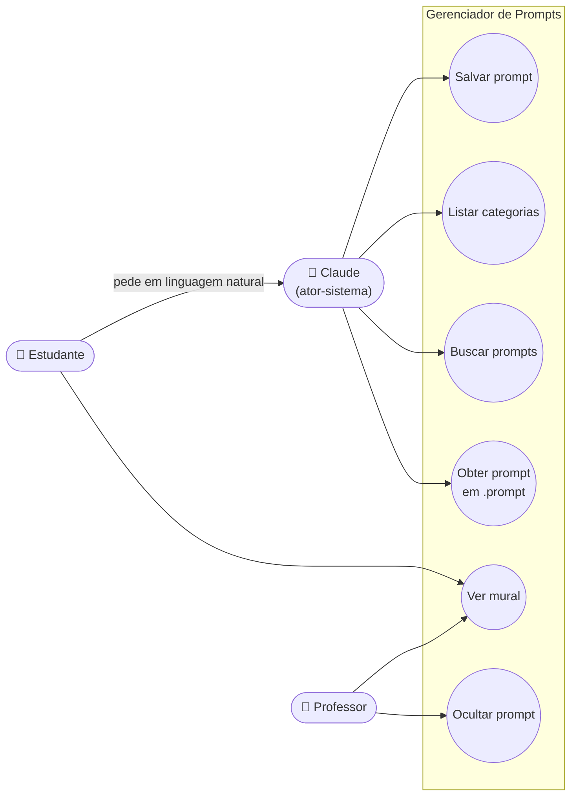

# 2. Diagrama de casos de uso

O GitHub desenha os diagramas abaixo automaticamente (Mermaid). Mermaid não tem um tipo "caso de uso" oficial, então usamos um fluxograma com a mesma convenção: atores à esquerda, casos de uso (elipses) dentro da fronteira do sistema.

## Ponto para discussão

O estudante **não** chama o sistema diretamente: ele conversa com o Claude, e o Claude decide qual ferramenta usar. Por isso o Claude aparece como **ator-sistema**. Esse é um caso clássico da UML: um ator não precisa ser uma pessoa, pode ser outro sistema.

## Especificação resumida: "Salvar prompt"

| Campo | Descrição |
|---|---|
| Ator principal | Claude (a pedido do estudante) |
| Pré-condição | O conector está adicionado à conta do estudante |
| Fluxo principal | 1. Estudante escreve "salva esse prompt na categoria X". 2. Claude chama `salvar_prompt`. 3. Sistema valida e grava. 4. Sistema devolve o id. 5. Claude confirma ao estudante. 6. O prompt aparece no mural. |
| Fluxo alternativo | 3a. Texto acima de 4.000 caracteres: o sistema recusa e explica o motivo. |
| Pós-condição | Prompt gravado e visível no mural |
