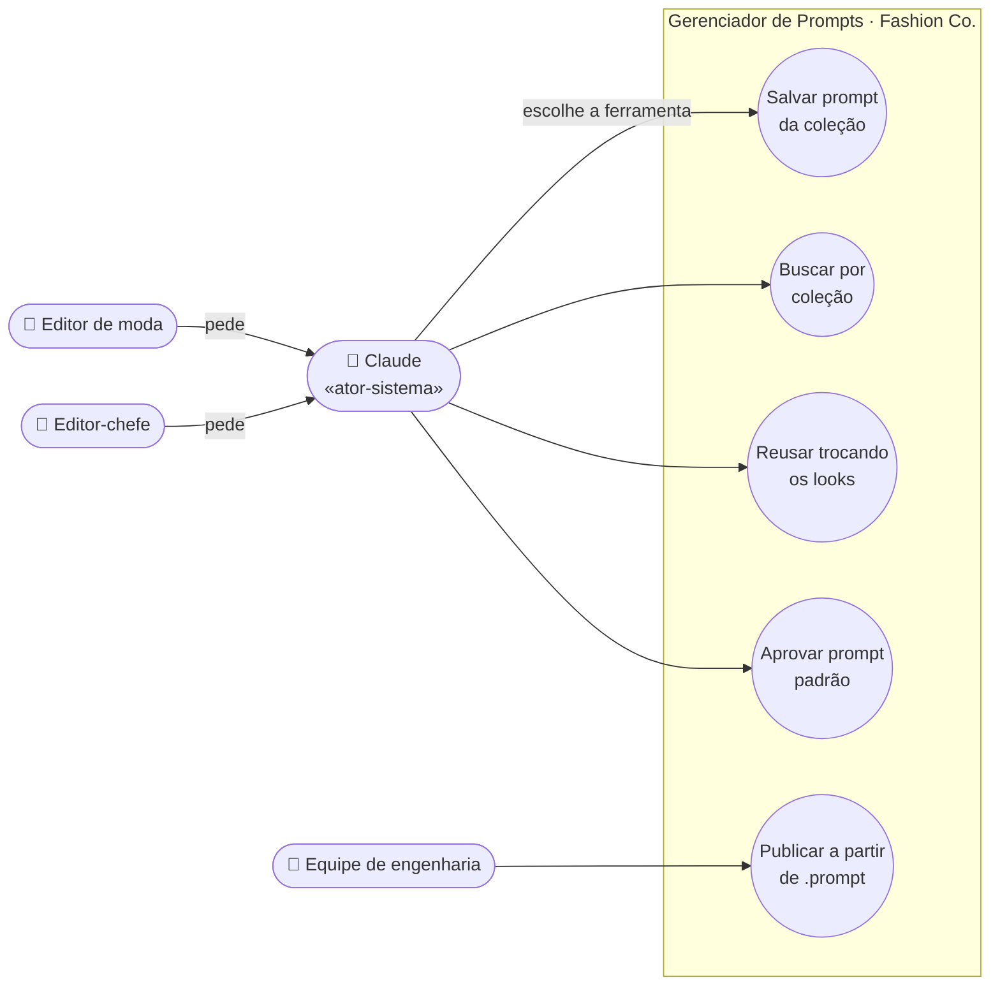

# 2. Diagrama de casos de uso

Do editor de moda ao engenheiro. O GitHub desenha o diagrama abaixo automaticamente (Mermaid). Mermaid não tem um tipo "caso de uso" oficial, então usamos um fluxograma com a mesma convenção: atores fora, casos de uso dentro da fronteira do sistema.

**Cada caso de uso ataca uma dor** (ver `01-requisitos.md`):

| Caso de uso | Dor que resolve | Ferramenta |
|---|---|---|
| Salvar prompt da coleção | Prompts soltos | `salvar_prompt` |
| Buscar por coleção | Prompts soltos | `buscar_prompts`, `listar_colecoes` |
| Reusar trocando os looks | Muita refação | `reusar_prompt` |
| Aprovar prompt padrão | Falta de padrão | `aprovar_prompt` |
| Publicar a partir de .prompt | O padrão chega à engenharia sem WhatsApp | `obter_prompt`, `entregar_colecao` |

## Ponto para discussão: o Claude como ator-sistema

O editor **não** chama o sistema diretamente: ele conversa com o Claude, e o Claude escolhe qual ferramenta usar. Por isso o Claude aparece como **ator-sistema**. É um caso clássico da UML: um ator não precisa ser uma pessoa, pode ser outro sistema.

## Especificação resumida: "Reusar trocando os looks"

| Campo | Descrição |
|---|---|
| Ator principal | Claude, a pedido do editor de moda |
| Pré-condição | Existe um prompt salvo com `{{look}}` no texto |
| Fluxo principal | 1. O editor pede: "usa o prompt do editorial de praia para estes looks: vestido midi verde-oliva de linho, conjunto de alfaiataria areia". 2. O Claude chama `reusar_prompt` com o id e a lista de looks. 3. O sistema troca o `{{look}}` por cada peça e registra os looks na coleção. 4. O sistema devolve um prompt pronto por look. 5. O Claude mostra os prompts para a IA de imagem. |
| Fluxo alternativo | 3a. O prompt não tem `{{look}}`: o sistema recusa e sugere salvar uma versão com `{{look}}` no lugar da peça. |
| Fluxo alternativo | 4a. O prompt ainda é rascunho: o sistema gera os looks, mas avisa que ele não é o padrão aprovado. |
| Pós-condição | Looks registrados na coleção, prontos para a entrega à engenharia |
