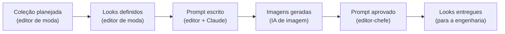
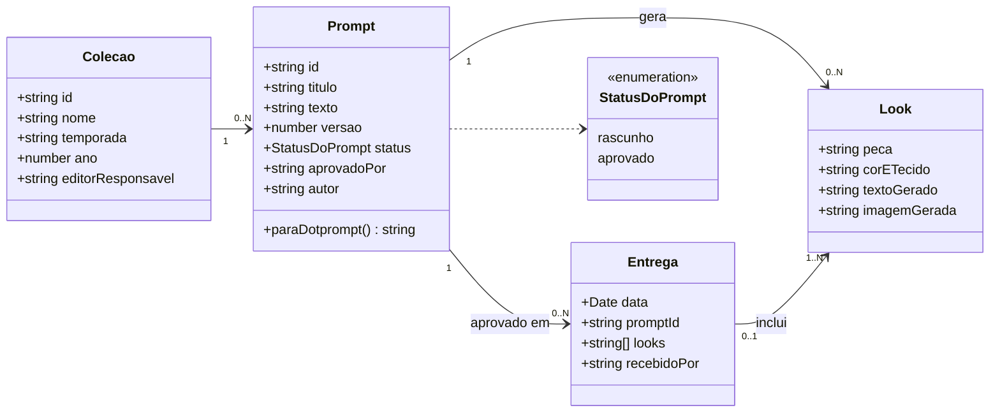
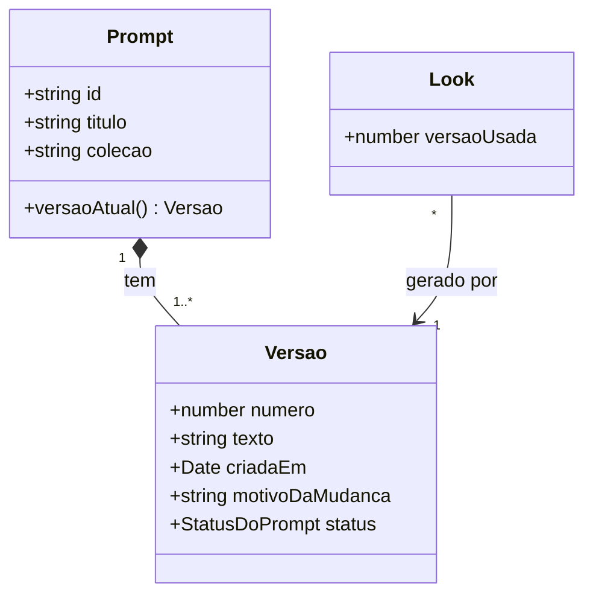

# 3. Modelo de domínio e diagrama de classes

Dos acontecimentos do negócio às coisas que o sistema guarda.

## 1. Event Storming: a troca de coleção contada em eventos

Cada evento é algo que **aconteceu** no negócio, escrito no passado, com quem o provocou:

> **Event Storming** foi criado por Alberto Brandolini por volta de 2013. Nasceu dentro do *Domain-Driven Design* (DDD), que é de onde vem o termo "modelo de domínio".

## 2. O modelo de domínio que sai dos eventos

Os substantivos que se repetem nos eventos viram as classes:

O `texto` do prompt usa `{{look}}` onde a peça muda. O código desse modelo está em [`functions/src/modelo.ts`](../functions/src/modelo.ts).
Uma entrega associa um prompt aprovado e **um ou mais looks**; cada look pode estar sem entrega ou pertencer a uma única entrega. `imagemGerada` existe no modelo, mas não é preenchida na v1.

### Decisões de projeto para discutir

- **Um só aprovado por coleção.** Aprovar um prompt devolve o antigo padrão a rascunho. É uma regra de negócio, não uma limitação técnica.
- **Uma entrega precisa conter ao menos um look.** Sem looks gerados, o sistema não registra a entrega para engenharia.
- **O `{{look}}` é uma variável.** O mesmo prompt gera um look por peça, e na exportação `.prompt` ele vira a entrada declarada (`input.schema`).
- **`versao` existe, mas é sempre 1.** O campo está no modelo para o desafio da v3.
- **`imagemGerada` existe, mas a v1 não preenche.** Gerar a imagem é trabalho da IA de imagem, fora deste sistema.

## Desafio v3: versões de cada prompt (H06)

Hoje, alterar um prompt apagaria o texto anterior, e quem já usou a versão antiga perde a referência. Uma resposta possível:

Cada look **fixa** a versão que o gerou. Uma mudança no prompt cria uma `Versao` nova, e dá para comparar as coleções.
