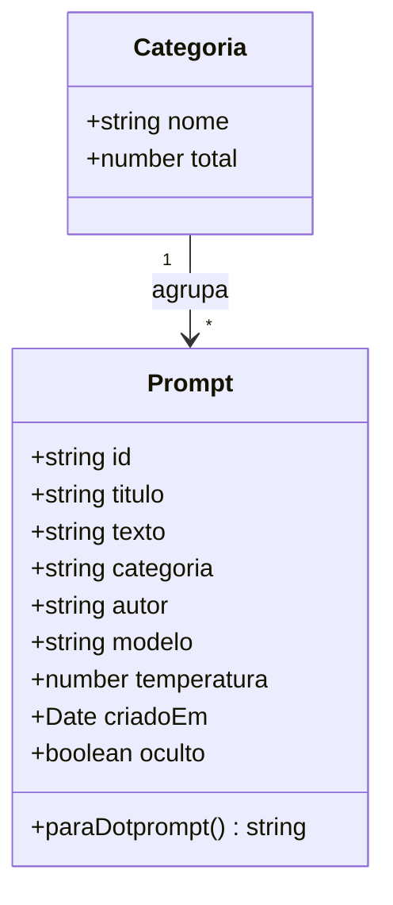
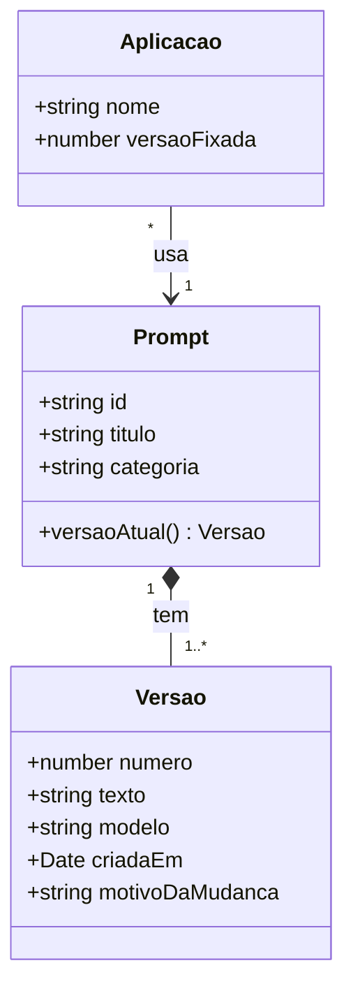

# 3. Diagrama de classes

Ponto de partida: a classe `Prompt` do livro da Chip Huyen (cap. 5), escrita em Python com Pydantic:

```python
class Prompt(BaseModel):
    model_name: str
    date_created: datetime
    prompt_text: str
    application: str
    creator: str
```

Ela já é, quase, um diagrama de classes. Abaixo, a versão deste projeto.

## Versão 1 (o que está implementado)



Na versão 1, `Categoria` não é guardada à parte: ela é **derivada** dos prompts (o sistema conta quantos prompts há em cada categoria). Isso é uma decisão de projeto que vale discutir.

## Atividade: versão 2

O livro aponta um problema: se várias aplicações usam o mesmo prompt e ele é alterado, todas mudam juntas. Como resolver? Uma resposta possível:



Cada aplicação **fixa** a versão que usa. Uma mudança no prompt cria uma `Versao` nova sem quebrar quem depende da antiga.
