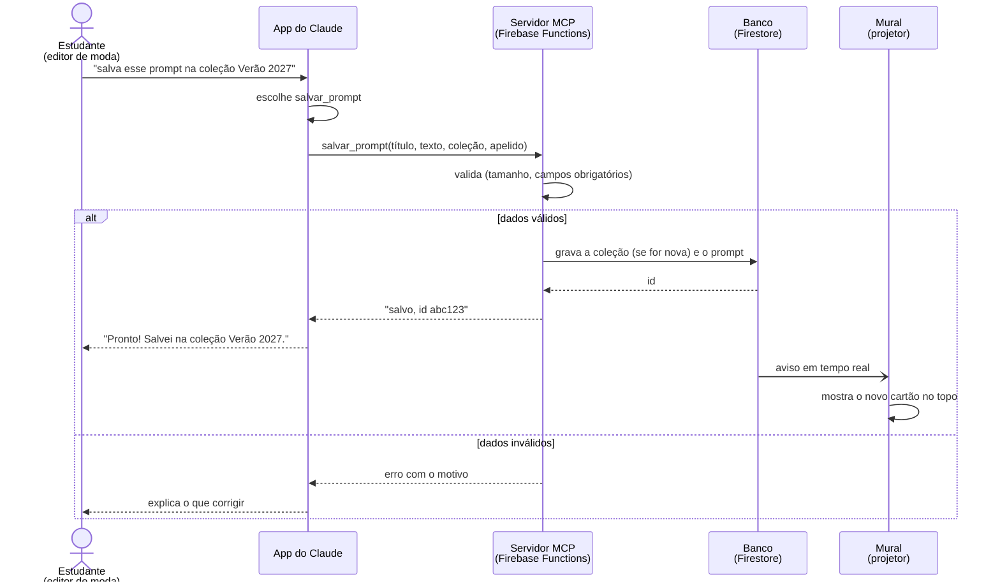

# 4. Diagrama de sequência

O caminho de uma frase, da conversa ao mural.

## Perguntas para a turma

1. Quem decide chamar `salvar_prompt`: o estudante ou o Claude?
2. O mural pergunta ao banco se há novidade (*polling*) ou o banco avisa o mural (*push*)? Que requisito não funcional isso atende? (Dica: RNF01.)
3. Onde, nesta sequência, ficaria a verificação de login da versão 2?
4. Desenhe a sequência de `aprovar_prompt`. Quantas mensagens ela tem a mais que a de salvar? (Dica: o antigo padrão volta a rascunho.)
