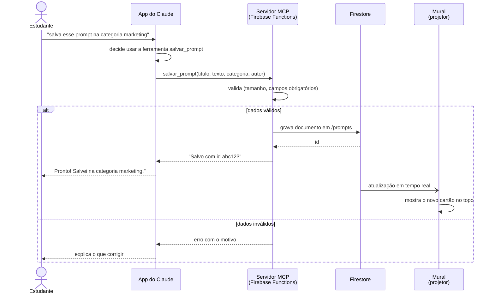

# 4. Diagrama de sequência

O caminho que uma frase percorre do celular do estudante até o mural no projetor.

## Perguntas para a turma

1. Quem decide chamar `salvar_prompt`: o estudante ou o Claude?
2. O mural pergunta ao banco se há novidade (*polling*) ou o banco avisa o mural (*push*)? Que requisito não funcional isso atende?
3. Onde, nesta sequência, ficaria a verificação de login da versão 2?
