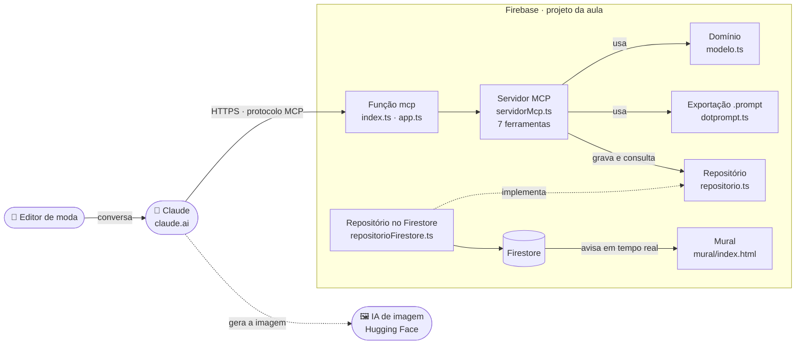

# 7. Projeto: como vamos construir

A análise respondeu **o que** o sistema faz (requisitos, casos de uso, modelo de domínio). O projeto responde **como** construir, antes de escrever código.

| Fase | Pergunta | Produto |
|---|---|---|
| **Análise** | O que o sistema faz? | Requisitos, casos de uso e modelo de domínio (`01` a `04`) |
| **Projeto** | Como vamos construir? | As decisões técnicas e a arquitetura que sai delas (este documento) |
| **Implementação** | Construir e testar | Código (`functions/src`, `mural/`) e testes (`teste.ts`) |

## Decisões técnicas

Toda decisão tem alternativas e consequências. Registrar o porquê, antes de codar, é o que em inglês se chama **ADR** (*Architecture Decision Record*): quem chegar depois entende a escolha em vez de adivinhá-la.

| Decisão | Escolha | Alternativas | Por quê | Consequência |
|---|---|---|---|---|
| **Integração** | Conector MCP | App ou site próprio | O editor já trabalha no Claude; MCP é o padrão aberto, criado pela Anthropic, para ligar ferramentas a assistentes | Exige um servidor na internet; o usuário precisa de um cliente MCP (Claude ou outro) |
| **Plataforma** | Firebase (Functions, Firestore, Hosting) | Servidor próprio, Cloud Run, Vercel | Sem servidor para manter (RNF05); hospedagem e banco no mesmo lugar; cota gratuita cobre uma turma | Functions exige o plano Blaze (cartão cadastrado); dependência do Google |
| **Linguagem** | TypeScript | Python | O SDK oficial do MCP em TypeScript é a implementação de referência; o mural já é JavaScript, então uma linguagem só; tipos pegam erros antes de rodar | Quem programa só em Python precisa aprender. Python atenderia (SDK `mcp`), mas mudaria a plataforma: em Python, as Functions não rodam esse servidor sem um adaptador, e o caminho natural seria o Cloud Run |
| **Banco** | Firestore | PostgreSQL ou outro SQL | Avisa o mural em tempo real (RNF01); sem servidor; documentos simples | Não busca por trecho de texto: a busca filtra os 500 prompts mais recentes em memória; sem *joins* |
| **Formato** | Dotprompt (`.prompt`) | JSON, texto puro | Padrão de mercado do Firebase Genkit (RNF03); o `{{look}}` vira entrada declarada | A engenharia precisa conhecer o formato |

As decisões vêm depois dos requisitos e **moldam a arquitetura**: o desenho abaixo já mostra Firebase, Firestore e TypeScript porque essas escolhas foram feitas antes. A linguagem não é ponto de partida: é uma decisão como as outras, e poderia ser outra.

### Revisão de uma decisão (12/10/2026)

A decisão da linguagem foi posta à prova: o servidor foi reescrito em Python, fatia por fatia, com os mesmos testes (ramo [`python`](https://github.com/brevvi/gerenciador-prompts/tree/python)). Funcionou, inclusive gravando no mesmo Firestore. Mesmo assim, **a decisão foi mantida**:

- a versão em TypeScript já está no ar e foi testada no ensaio da aula;
- em Python, a plataforma também teria de mudar (Cloud Run no lugar das Functions): uma decisão puxa a outra;
- a três semanas da aula, trocar a infraestrutura é risco sem ganho para quem vai usar.

Registrar a revisão, e não só a decisão, é o que deixa o histórico honesto: quem chegar depois sabe que a alternativa foi testada, e por que não foi adotada.

## Arquitetura: as peças e como elas conversam

### Onde está cada peça no código

| Peça | Arquivo | O que faz |
|---|---|---|
| Função mcp | [`functions/src/index.ts`](../functions/src/index.ts), [`app.ts`](../functions/src/app.ts) | Publica a função no Firebase e recebe as chamadas HTTP do Claude. |
| Servidor MCP | [`functions/src/servidorMcp.ts`](../functions/src/servidorMcp.ts) | As 7 ferramentas que o Claude enxerga, com as regras de negócio (casos de uso). |
| Domínio | [`functions/src/modelo.ts`](../functions/src/modelo.ts) | Coleção, Prompt, Look e Entrega; os limites; a troca do `{{look}}`. |
| Exportação | [`functions/src/dotprompt.ts`](../functions/src/dotprompt.ts) | Converte o prompt para `.prompt` (RNF03). |
| Repositório | [`functions/src/repositorio.ts`](../functions/src/repositorio.ts) | A interface do que se guarda e consulta, e uma versão em memória para os testes. |
| Repositório no Firestore | [`functions/src/repositorioFirestore.ts`](../functions/src/repositorioFirestore.ts) | A mesma interface, gravando no Firestore. |
| Mural | [`mural/index.html`](../mural/index.html) | A página do projetor: escuta o Firestore e mostra os cartões (RF03, RNF01). |
| Testes | [`functions/src/teste.ts`](../functions/src/teste.ts) | Faz o papel do Claude e percorre salvar, buscar, reusar, aprovar e entregar. |

**A decisão mais importante do desenho:** o servidor não sabe qual banco usa. Ele conversa com a interface `Repositorio`. Por isso os testes rodam sem Firebase, e trocar o banco não mexe nas ferramentas.

**O que fica fora do sistema:** a conversa (Claude) e a geração da imagem (IA de imagem). O sistema guarda e entrega; não gera.

## Perguntas para a turma

1. Se o requisito RNF01 (mural em menos de 2 segundos) não existisse, o Firestore ainda seria a melhor escolha?
2. Que peças do diagrama mudariam se o sistema fosse reescrito em Python? E quais não mudariam?
3. Onde, no diagrama, entraria a verificação de login do desafio v2?
