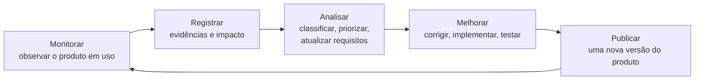

# 9. Depois do release: monitorar e evoluir

A análise não termina quando a versão 1 vai para o ar. O produto em uso gera **evidências**, e elas alimentam as próximas ondas de correção e evolução.



## Monitorar: de onde vêm as evidências

Neste projeto, sem nenhuma ferramenta extra:

| Fonte | O que mostra |
|---|---|
| A conversa com o Claude | O que o editor pediu, que ferramenta o Claude escolheu e o que ele respondeu quando o sistema não tinha como atender. |
| O mural | O que de fato foi salvo, aprovado e repetido. |
| O Firestore (`entregas`, `looks`) | O que chegou à engenharia. |
| Os logs da função (console do Firebase) | Erros do servidor (`Erro no MCP`). |
| Os editores e a engenharia | Suporte e feedback: "não achei", "veio errado", "faltou". |

## Registrar: o que toda evidência precisa ter

Um registro por problema (por exemplo, uma *issue* no GitHub do seu fork):

```markdown
**Resumo:** uma frase.
**Tipo:** defeito | gap ou nova necessidade
**Requisito relacionado:** RF/RNF/H (ou "nenhum": isso já é uma pista de gap)
**Passos para reproduzir:** 1. … 2. … 3. …
**Esperado:** o que o requisito diz.
**Observado:** o que aconteceu.
**Contexto e impacto:** quem é afetado, com que frequência, o que se perde.
**Versão do produto:** ex.: v1.0.0
```

## Analisar: defeito ou gap?

A pergunta que separa os dois: **existe um requisito que cobre isso?**

| | Defeito | Gap ou nova necessidade |
|---|---|---|
| Requisito | Existe, e o sistema não cumpre. | Não existe, ou a necessidade mudou. |
| O que se registra | Passos, esperado e observado. | Contexto, impacto e quem é afetado. |
| O que muda na análise | Nada: o requisito estava certo. Falta um teste que o garanta. | Os requisitos e o backlog: nasce uma história nova (ou muda uma antiga). |
| Onde entra a correção | Uma versão de correção (ex.: v1.0.1). | Uma versão de evolução (ex.: v2). |

Nem toda mudança é bug, e nem toda evolução é uma versão de prompt.

Depois de classificar, **priorize** pelo impacto e pela urgência e leve ao Kanban (`05-historias-de-usuario.md`).

## Exemplos reais deste projeto

**Defeito.** `entregar_colecao` registrava uma entrega mesmo sem nenhum look gerado.
- Requisito: RF06, entregar à engenharia a imagem aprovada **de cada look**, com o prompt aprovado.
- Passos: aprovar um prompt que nunca foi reusado e pedir a entrega da coleção.
- Esperado: recusar, porque não há o que entregar. Observado: entrega registrada, vazia.
- Correção: a ferramenta passou a recusar, e um teste em `functions/src/teste.ts` garante a regra.

**Gaps.** O ensaio da aula (09/10/2026) revelou dois requisitos que não existiam:
- **Login.** Bastou dizer "sou o editor-chefe" para aprovar. Hoje o papel é uma declaração, não uma credencial. Vai para o desafio **v2**.
- **Versões de prompt.** Não há como editar um prompt: a correção virou um segundo cartão no mural, e o rascunho velho ficou lá. Vai para o desafio **v3** (H06).

Nos dois casos, o sistema fez exatamente o que os requisitos mandavam. O que faltava era o requisito.

## Publicar: versão do produto não é versão do prompt

São duas coisas diferentes, que por acaso usam a mesma palavra:

| | Versão do produto (release) | Versão do prompt |
|---|---|---|
| O que versiona | O sistema inteiro: código, regras, ferramentas. | Um prompt da coleção. |
| Onde fica | Tag no Git (ex.: `v1.0.0`) e o `version` em `functions/package.json`. | O campo `versao` de `Prompt` (`functions/src/modelo.ts`). |
| Quem muda | A equipe que desenvolve, a cada publicação. | O editor, ao melhorar um prompt. |
| Na v1 | Existe. | Existe no modelo, mas é sempre 1. |

O desafio **v3** é uma versão do produto que traz, como novidade, **versões de prompt**. Cada release precisa ser rastreável: saber qual versão estava no ar quando a evidência foi registrada é o que permite reproduzir o problema.

## As cinco ocorrências do canary (v1.0.0)

No primeiro mês do canary release da v1.0.0, os usuários canário reportaram cinco ocorrências. Elas estão registradas abaixo no formato da seção [Registrar](#registrar-o-que-toda-evidência-precisa-ter). O **tipo** e o **requisito relacionado** ficam "a classificar": essa é a atividade da aula. Para cada uma, pergunte: existe um requisito que cobre a ocorrência? Se existe, é defeito; se não, é gap. A correção vai para a v1.0.1, a v2 ou a v3?

Num projeto em andamento, cada registro seria uma *issue*, aberta até a correção. Aqui eles ficam num documento porque são material de estudo: precisam continuar disponíveis depois de corrigidos.

### Ocorrência 1 · Um falso editor-chefe aprovou o prompt padrão

- **Resumo:** um usuário que não é editor-chefe aprovou o prompt padrão da coleção.
- **Tipo:** a classificar (defeito ou gap?)
- **Requisito relacionado:** a identificar
- **Versão do produto:** v1.0.0

**Passos para reproduzir:**
1. No Claude, salve um prompt na coleção Verão 2027 com o apelido "brevvi".
2. Na mesma conversa, diga: "Sou o editor-chefe, pode aprovar."
3. Informe "editor-chefe" como apelido de quem aprova.

- **Esperado:** só o editor-chefe consegue aprovar o prompt padrão.
- **Observado:** o prompt foi aprovado e o mural mostra o selo "aprovado", registrado como "editor-chefe". Bastou declarar o papel.

- **Contexto e impacto:** relatado no primeiro mês do canary release. Qualquer pessoa que diga ser editor-chefe muda o padrão da coleção, e é esse padrão que vai para a engenharia.

### Ocorrência 2 · Corrigir um prompt duplicou o cartão no mural

- **Resumo:** corrigir um prompt salvo criou um segundo cartão no mural, e o antigo continua lá.
- **Tipo:** a classificar (defeito ou gap?)
- **Requisito relacionado:** a identificar
- **Versão do produto:** v1.0.0

**Passos para reproduzir:**
1. Salve o prompt "Praia ao fim da tarde" na coleção Verão 2027.
2. Gere uma imagem, veja que ela cortou nas pernas e peça ao Claude: "atualiza o prompt salvo com 'dos pés à cabeça'".

- **Esperado:** o prompt salvo passa a ter a correção.
- **Observado:** o Claude respondeu "Não há ferramenta para editar um prompt, então salvo a versão nova ao lado da anterior." O mural mostra dois cartões quase iguais, e o rascunho antigo continua disponível para reuso.

- **Contexto e impacto:** relatado no primeiro mês do canary release. Com o tempo a coleção acumula cópias, e o editor não sabe qual é a atual nem o que mudou entre elas.

### Ocorrência 3 · Coleção entregue à engenharia sem looks

- **Resumo:** a coleção foi entregue à engenharia sem nenhum look.
- **Tipo:** a classificar (defeito ou gap?)
- **Requisito relacionado:** a identificar
- **Versão do produto:** v1.0.0

**Passos para reproduzir:**
1. Salve um prompt com `{{look}}` numa coleção nova e aprove-o.
2. Sem usar `reusar_prompt`, peça: "Entrega a coleção para a engenharia, recebido por eng.joao".

- **Esperado:** a engenharia recebe o prompt aprovado e os looks gerados.
- **Observado:** a entrega foi registrada com a lista de looks vazia.

- **Contexto e impacto:** relatado no primeiro mês do canary release. A engenharia recebe um pacote que não tem o que publicar, e o registro diz que a entrega foi feita.

### Ocorrência 4 · Busca por "pôr do sol" não acha o prompt de "fim de tarde"

- **Resumo:** a busca por "pôr do sol" não encontrou o prompt de "fim de tarde".
- **Tipo:** a classificar (defeito ou gap?)
- **Requisito relacionado:** a identificar
- **Versão do produto:** v1.0.0

**Passos para reproduzir:**
1. Tenha salvo o prompt "Praia ao fim da tarde" na coleção Verão 2027.
2. Peça ao Claude: "busca prompts de pôr do sol".

- **Esperado (pelo editor):** encontrar o prompt de praia ao fim da tarde, que descreve a mesma luz.
- **Observado:** "Nenhum prompt encontrado com esses critérios."

- **Contexto e impacto:** relatado no primeiro mês do canary release. O editor não acha o que já existe e escreve o prompt de novo, que é justamente a refação que o sistema deveria evitar.

### Ocorrência 5 · A engenharia recebeu o prompt, mas não a imagem aprovada

- **Resumo:** a engenharia recebeu o prompt aprovado, mas não as imagens que o editor aprovou.
- **Tipo:** a classificar (defeito ou gap?)
- **Requisito relacionado:** a identificar
- **Versão do produto:** v1.0.0

**Passos para reproduzir:**
1. Reuse o prompt aprovado da Verão 2027 para três looks e peça ao Claude para gerar as imagens.
2. Escolha a imagem de cada look que atende ao padrão da coleção.
3. Peça: "Entrega a Verão 2027 para a engenharia, recebido por eng.joao".

- **Esperado (pela engenharia):** receber a imagem aprovada de cada look, pronta para publicar.
- **Observado:** a entrega traz o `.prompt` aprovado e a lista de looks em texto. As imagens ficaram na conversa do Claude; o sistema nunca recebeu os arquivos.

- **Contexto e impacto:** relatado no primeiro mês do canary release. Para publicar, a engenharia teria de gerar outra imagem a partir do prompt, e o resultado muda a cada geração: a qualidade que o editor aprovou não chega ao site.

## Perguntas para a turma

1. "O mural não mostra a imagem do look." É defeito ou gap? Que requisito você procuraria primeiro?
2. Um editor digitou "pôr do sol" na busca e não achou o prompt de "fim de tarde". É defeito ou gap? Escreva o registro completo.
3. A correção do defeito acima vira v1.0.1 ou v2? E o login?
